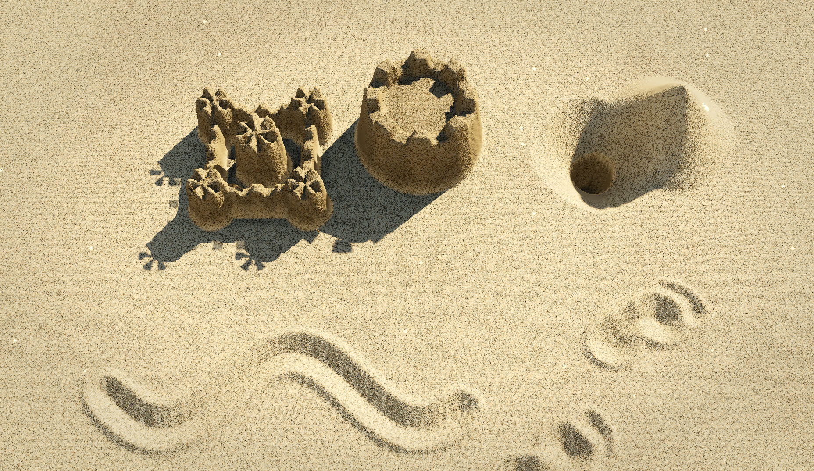

# Tidewrit

There is something oddly satisfying about dragging a finger through a perfectly smooth patch of sand and immediately ruining it in the best possible way.

Tidewrit is a fork of [Sandboard](https://github.com/scottstts/Sandboard) by Scott Sun (live at https://sand.scottsun.io), extended with new tools, water, digging and bucket molds, kinetic sand, time of day, and rendering work. It remains licensed under GPL-3.0.

Tidewrit is built around that feeling. Start with a quiet, untouched surface, draw a line, carve a shape, scribble too fast, use two hands, make a mess, then smooth everything away and start again.

The sand is meant to feel playful rather than precious. Slow movements leave deliberate marks. Fast ones kick things up. A tiny gesture can become a neat little groove; a reckless swipe can turn into a miniature landslide.

On a phone or tablet, several fingers can join in at once, which makes Tidewrit less like a drawing tool and more like a small patch of beach that happens to live under glass.

There is no score, no objective, and no correct thing to make. The whole point is the moment between a clean surface and whatever you decide to do to it next.

## Credits and licence

Tidewrit is a modified version of **Sandboard** by **Scott Sun** ([source](https://github.com/scottstts/Sandboard), [live](https://sand.scottsun.io)). The sand simulation it starts from, and the beach and wave sounds, come from that project.

Copyright (C) 2026 Scott Sun (Sandboard)
Copyright (C) 2026 Ruben Vieira (modifications)

**Modified by Ruben Vieira, from 13 October 2026:** new tools, water, digging and bucket molds, kinetic sand, time of day, the zen garden and sand writing, rendering work and the shared Play interface. The commit history records every change.

This project is licensed under the GNU General Public License v3.0 (GPL-3.0-only).

You may use, modify, and redistribute this software under the terms of the GPLv3. If you distribute a modified or derivative version of this project, you must also make the corresponding source code available under the GPLv3.

See the [LICENSE](./LICENSE) file for the full license terms.
